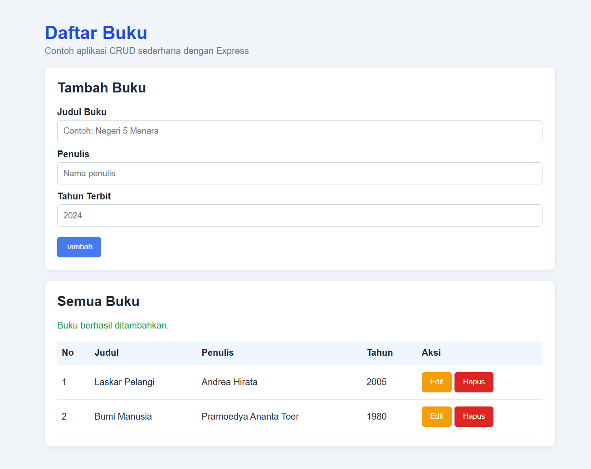
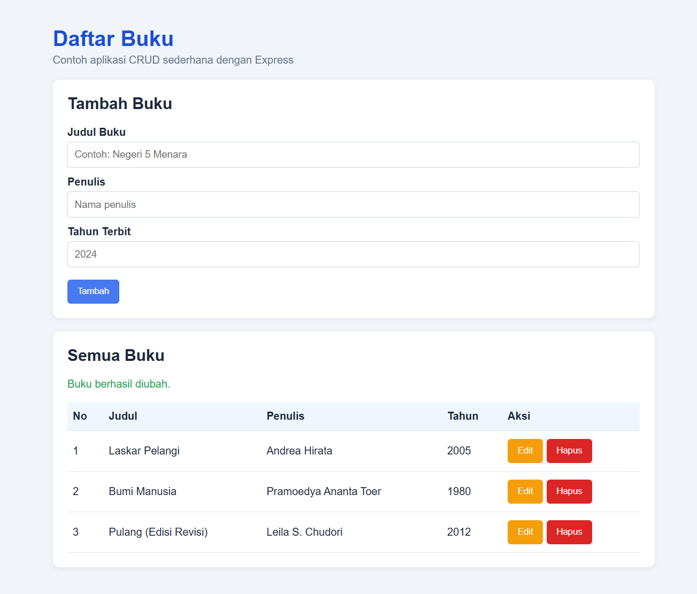
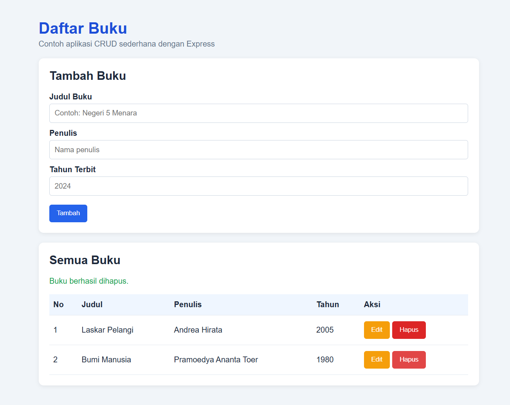
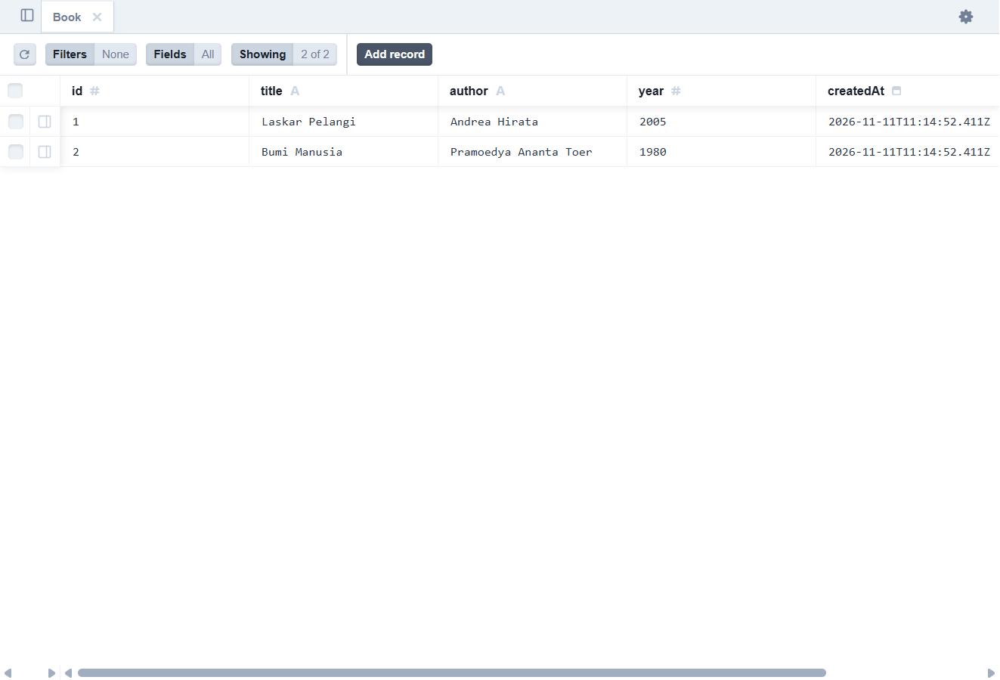
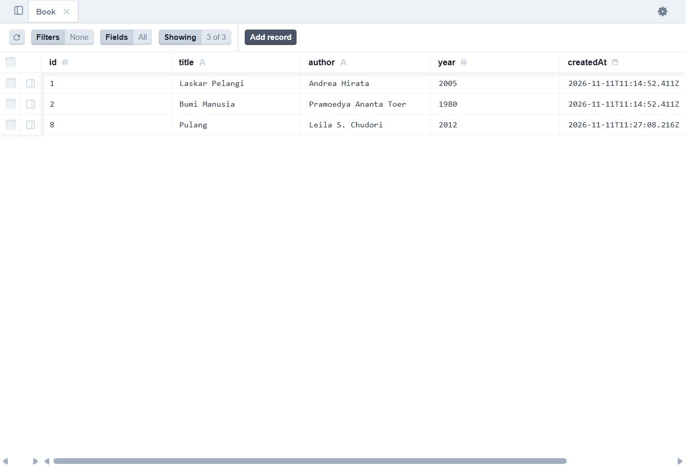

## Evidence laporan

Lampirkan screenshot berikut:

1. Halaman aplikasi sebelum dan sesudah menambah buku.
2. Halaman aplikasi setelah mengedit buku.
3. Dialog/tampilan setelah menghapus buku.
4. Neon SQL Editor atau Prisma Studio sebelum perubahan data.
5. Neon SQL Editor atau Prisma Studio sesudah perubahan data, yang menunjukkan baris buku bertambah, berubah, dan terhapus.

Jangan commit file `.env`; gunakan `.env.example` untuk dokumentasi konfigurasi.
2bcffa3 (Menambahkan Prisma Neon dan laporan evidence)
# Laporan Evidence CRUD Buku

## Identitas project

- Teknologi: Express.js, Prisma ORM, Neon PostgreSQL.
- URL demo lokal: `http://localhost:3000`
- Database: tabel `Book` pada Neon PostgreSQL.

## Skenario aplikasi

### 1. Menampilkan data awal (GET)

Buka `http://localhost:3000` dan ambil screenshot tabel yang berisi:

- Laskar Pelangi — Andrea Hirata — 2005
- Bumi Manusia — Pramoedya Ananta Toer — 1980


### 2. Menambah buku (POST)

Isi form dengan:

- Judul: `Pulang`
- Penulis: `Leila S. Chudori`
- Tahun: `2012`

Klik **Tambah**. Pastikan muncul pesan **Buku berhasil ditambahkan.**



### 3. Mengubah buku (PUT)

Klik **Edit** pada buku `Pulang`, ubah judul menjadi `Pulang (Edisi Revisi)`, lalu klik **Simpan Perubahan**. Pastikan muncul pesan **Buku berhasil diubah.**



### 4. Menghapus buku (DELETE)

Klik **Hapus** pada buku `Pulang (Edisi Revisi)` dan konfirmasi. Pastikan muncul pesan **Buku berhasil dihapus.**



## Perubahan database: before dan after

Gunakan **Prisma Studio**:

```bash
npm run prisma:studio
```

Buka `http://localhost:5555`, pilih model **Book**, kemudian screenshot tabel sebelum dan sesudah proses tambah/edit/hapus.

### Before

Kondisi awal tabel berisi 2 baris:

```text
1 | Laskar Pelangi | Andrea Hirata          | 2005
2 | Bumi Manusia   | Pramoedya Ananta Toer  | 1980
```



### After

Setelah skenario tambah, edit, dan hapus selesai, jalankan kembali seed data demo atau tambahkan satu data `Pulang` agar perubahan penambahan terlihat. Kondisi akhir yang disiapkan untuk screenshot:

```text
1 | Laskar Pelangi | Andrea Hirata          | 2005
2 | Bumi Manusia   | Pramoedya Ananta Toer  | 1980
8 | Pulang         | Leila S. Chudori       | 2012
```



## Query verifikasi Neon SQL Editor

Query untuk membuktikan data di Neon:

```sql
SELECT id, title, author, year, "createdAt", "updatedAt"
FROM "Book"
ORDER BY id;
```

Screenshot hasil query tersebut dapat digunakan sebagai evidence tambahan.

## Kesimpulan

Seluruh operasi CRUD berhasil terhubung ke database Neon PostgreSQL melalui Prisma:

- GET membaca data dari Neon.
- POST menyimpan data baru ke Neon.
- PUT memperbarui data di Neon.
- DELETE menghapus data dari Neon.

